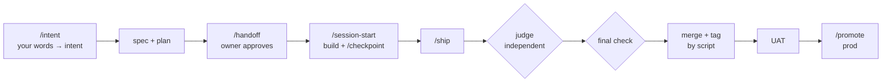

# ADLC kit

**An agentic development life cycle you can install in a repo with one prompt.**
Your coding agent turns your words into an approved intent, a spec and a build. A second, independent reviewer judges the result. Scripts, not the agent, merge, tag and deploy, and only when the gates you set are green.

It works with the tools you already have. GitHub, Claude Code and Codex are tested. Everything else plugs in through small adapters, and the install prompt helps your own agent write the ones you need.



## Install

Paste this into your coding agent, inside the repo you want to enable:

```text
Install the ADLC kit in this repository.
1. Clone https://github.com/stLalo/adlc-kit next to this repo if it is not on this machine yet.
2. Read AGENTS.md and docs/install/AGENT_INSTALL.md in that clone and follow them exactly.
Start with the read-only discovery, write ADLC_ADAPTATION_PLAN.md, and stop for my approval before you install anything.
```

Your agent looks at how you work (code host, CI, agents and models, spec tool, secrets, deploys), writes a plan that fits it, and waits for your yes. Details and the manual steps: [INSTALL.md](INSTALL.md).

## What you get

- **Eight commands** that carry work from idea to production: `/sessions`, `/intent`, `/handoff`, `/session-start`, `/checkpoint`, `/ship`, `/promote`, `/session-close`. They are plain markdown playbooks, so any agent can run them. → [docs/flow.md](docs/flow.md)
- **Stages that hand off through files.** Intent, spec, build prompt, checkpoints and recaps are committed. A fresh session, another model or another person can pick up exactly where the last one stopped.
- **An independent judge.** A different model reviews every pull request against the spec's acceptance criteria and posts findings. No second model? A person can be the judge.
- **Gates the agent cannot talk its way past.** Merge, tag and deploy run through scripts that check the judge, the final check, the tests and your policy on the exact commit. Prod needs UAT evidence and a rollback command.
- **A guard.** Where your agent supports hooks, direct merges, tags, pushes to protected branches and edits to closed sessions are blocked before they run.
- **Honest limits.** [docs/security-model.md](docs/security-model.md) says what each layer stops, and what only server-side branch protection can stop.

## What works today

| Part | Tested by maintainers | Bring your own (contract + template + tests) |
|---|---|---|
| Code host | GitHub (github.com, GitHub Enterprise) | GitLab, Bitbucket, Azure DevOps, Gitea, in-house |
| Coding agent | Claude Code (commands, subagents, hooks) · Codex CLI (instructions + git hook) · any agent via git hooks | GitHub Copilot, Cursor, others |
| Judge | Codex · Claude Code · a human reviewer | any CLI that can read files and return JSON |
| Spec tool | OpenSpec · plain markdown | any tool with a folder per change |
| Agent identity | your own login · GitHub App bot | any bot credential your host offers |
| Secrets | environment or file · any secret manager CLI | |

Full matrix with what "tested" means: [docs/compatibility.md](docs/compatibility.md). Adding a row is the most useful contribution: [CONTRIBUTING.md](CONTRIBUTING.md).

## How it is built

```
core/        neutral: scripts, guard, playbooks, role briefs, templates. Names no vendor.
adapters/    one small piece per tool: host, harness, judge, spec, identity, secrets.
docs/        concepts, the flow, the security model, how to adapt it, decisions.
tests/       offline suite, host conformance suite, public-content scan.
```

- [docs/concepts.md](docs/concepts.md): the ideas in ten minutes.
- [docs/adapting.md](docs/adapting.md): fit the kit to your tools; write an adapter.
- [docs/server-gate.md](docs/server-gate.md): the branch protection that makes the gates hold.

## Requirements

bash 3.2+, git 2.23+, Python 3.8+, and the CLI of your code host. For the shipped adapters: `gh`, plus `codex` or `claude` for the judge. Linux and macOS (CI runs both). Windows: use WSL.

## Status

Version 0.x. The flow has run real work in private repositories; this public kit is the same flow with the vendor-specific parts moved into adapters. Expect changes before 1.0: [CHANGELOG.md](CHANGELOG.md).

## License

[Apache-2.0](LICENSE).
