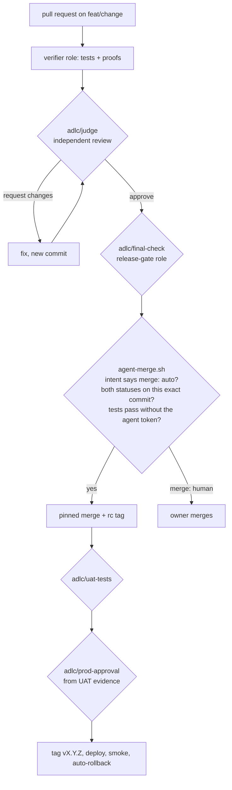

# Concepts

Ten minutes to understand why the kit is shaped the way it is.

## The problem

A coding agent can write a feature in an afternoon. What goes wrong is around the code:

- The agent built what it understood, not what you meant.
- The session ran out of context and the next one started from a guess.
- The same model that wrote the code said the code was fine.
- "It is merged" was true before the tests, the review or you agreed.

The kit answers each with one rule.

## Five rules

1. **Intent before spec, spec before code.** Your own words become an `intent.md` you approve: the problem, what good looks like as checkable lines, and the policy for this change (may it merge on its own, be tagged, be deployed).
2. **Stages hand off through committed files, never through a conversation.** Intent, spec, build prompt, checkpoints, decisions and recaps live in the repo. Any session, model or person can continue from them.
3. **The one who builds does not judge.** An independent reviewer, ideally a different model from a different vendor, checks each acceptance criterion against the diff.
4. **Scripts hold the keys.** The agent never merges, tags, posts a status or deploys directly. Scripts do, after checking the gates on the exact commit.
5. **Policy comes from the main branch.** A pull request cannot change its own rules: the scripts read the intent and the config as merged on the main branch, not the copy on the branch under review.

## Roles

| Role | Does | Typical choice |
|---|---|---|
| **Owner** | Says what they want, approves intents, owns the config, overrides gates. Always a person. | you |
| **Planner** | Interviews the owner, writes intent, spec, plan and the build prompt. | your strongest model |
| **Builder** | Implements from the build prompt, checkpoints, ships. | a fast model |
| **Judge** | Reviews the pull request against the spec. Read-only. Blocking. | a different model or vendor; or a person |
| **Releaser** | Mechanical final check before merge; decides prod from UAT evidence. Can block, never override the judge. | your strongest model, in a fresh context |

One model can play several roles. The fewer distinct models you have, the more you should lean on `merge: human`.

## Sessions

A session is one sitting of work with a goal, stored in `docs/sessions/<date>-<change>-<define|build>/`:

- `SESSION.md`: what it is and its status (`queued`, `active`, `in-review`, `complete`, `rolled-over`, `abandoned`).
- `STATE.md`: append-only checkpoints. The last one is the current state: commit, proofs, next action.
- `DECISIONS.md`: append-only, one line per decision with why and what was rejected.
- `RECAP.md`: written once at close.

A **define** session ends with a merged spec and a queued **build** session. A build session ends shipped, rolled over to a new session with a written brief, parked for the owner, or abandoned. Closed sessions are frozen.

## Gates

Every status is tied to one commit. A new commit means a new judgment.

## Core and adapters

`core/` is the process: scripts, guard, playbooks, roles, templates. It names no vendor. Everything tool-specific is an adapter:

| Adapter | Answers | Size of a new one |
|---|---|---|
| host | How do I open, read, merge a pull request and post a status here? | one bash file, about 30 small functions |
| harness | How does this coding agent start a playbook, run a role, get blocked? | an install script and notes |
| judge | How do I ask this reviewer for a JSON verdict? | about 10 lines |
| spec | Where do change folders live and what are the tool's steps? | about 10 lines of settings |
| identity | Who is the agent on the host? | one script that prints a token |
| secrets | Where does that identity's key come from? | about 15 lines |

Next: [flow.md](flow.md) for daily use, [adapting.md](adapting.md) to fit it to your tools.
